  

<h3 align="center">Hiring for AI strategy, AI transformation or technology roles? Let's talk.</h3>

Available from early 2027 · Open to relocation · English, French, Arabic

  
  
  
  

---

### Vision

Today, the chances you get in life still depend on where you were born. I believe every child should start with equal chances, and that organisations and regions should **own their intelligence instead of renting it**: their data, their AI models, their infrastructure and their decisions.

### Now

**Strategy Consultant in Digital Transformation** at Devoteam Digital Impulse, for Safran. Prioritising AI use cases, building AI agents and agentic workflows, and acting as the team's PMO.

### Lab

| Project | What it is | Built with |
|---|---|---|
| [**MegaMind**](https://github.com/JosephSbeiti/MegaMind) | A sovereign AI reasoning core, built from scratch. It persists knowledge, learns from experience and forms concepts. Now at v0.5.1, working on generalisation. | Python |
| [**Energy development profiles**](https://github.com/JosephSbeiti/energy-development-profiles) | Which countries share the same energy profile, and how closely does electricity follow wealth? 164 countries, 4 profiles, R² 0.83. | Python · pandas · scikit-learn |
| [**josephsbeiti.github.io**](https://josephsbeiti.github.io) | My interactive site: vision, journey, lab and toolkit. | HTML · CSS · JavaScript |

<b>Journey</b>

 

| When | What |
|---|---|
| 2026 – now | Strategy Consultant in Digital Transformation · Devoteam Digital Impulse, for Safran |
| 2026 | Master's thesis · Digital transformation for sustainable development in the Global South |
| 2025 – 2026 | MSc International Business, focused on AI & Data · NC State University / SKEMA, Raleigh |
| 2025 | Key Account Manager Assistant · SITA, aviation technology |
| 2023 | Sales Advisor · Louis Vuitton, Maison Vendôme |
| 2021 – 2025 | BBA in Global Management · SKEMA Business School · President of the 2025 class |

<b>Toolkit</b>

 

**Strategy** · AI business strategy · AI use-case prioritisation · Value measurement & ROI · Market & stakeholder analysis · Research

**AI, Data & Tools** · AI agents & agentic workflows · Prompt engineering & LLMs · Generative AI (certified) · Responsible AI · Python · K-means clustering · Linear regression · pandas

**Delivery** · PMO · Project management · Process & workflow redesign · Change & AI enablement · Executive reporting

**People** · Stakeholder management · Cross-functional collaboration · Client relationships · Key account management · English · French · Arabic

---

More on <a href="https://josephsbeiti.github.io">josephsbeiti.github.io</a>

